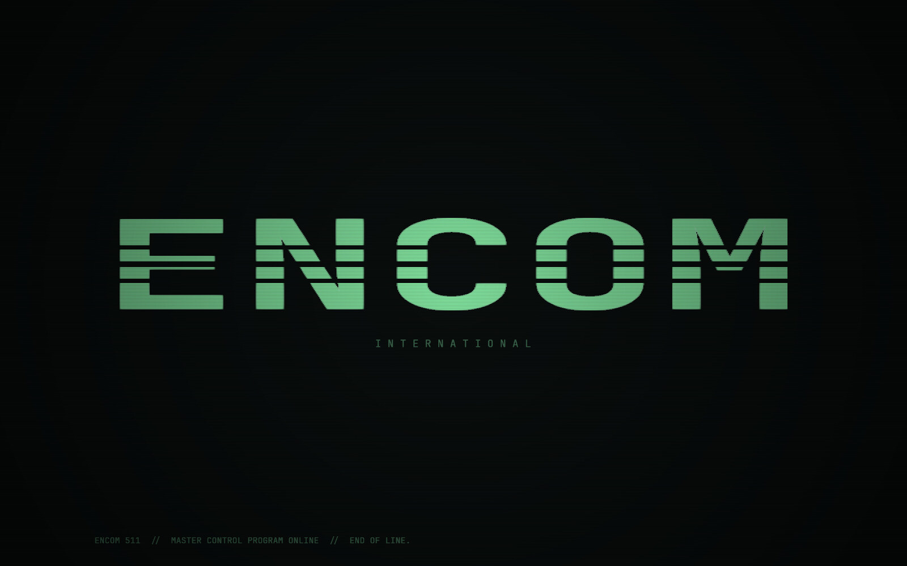
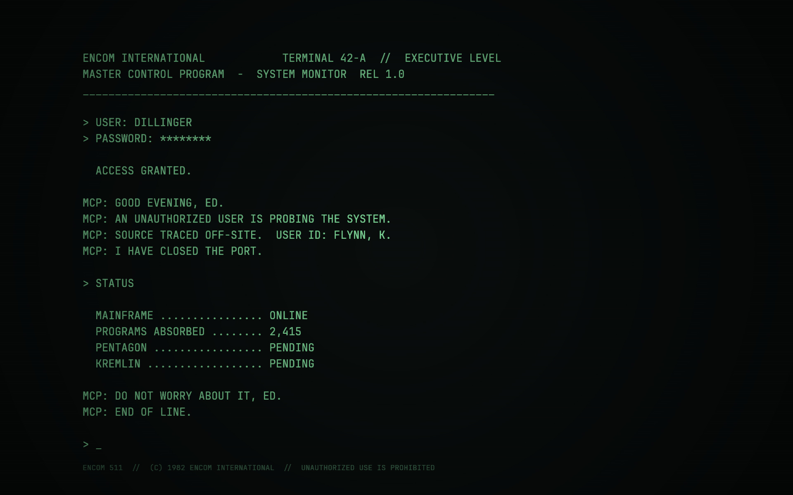
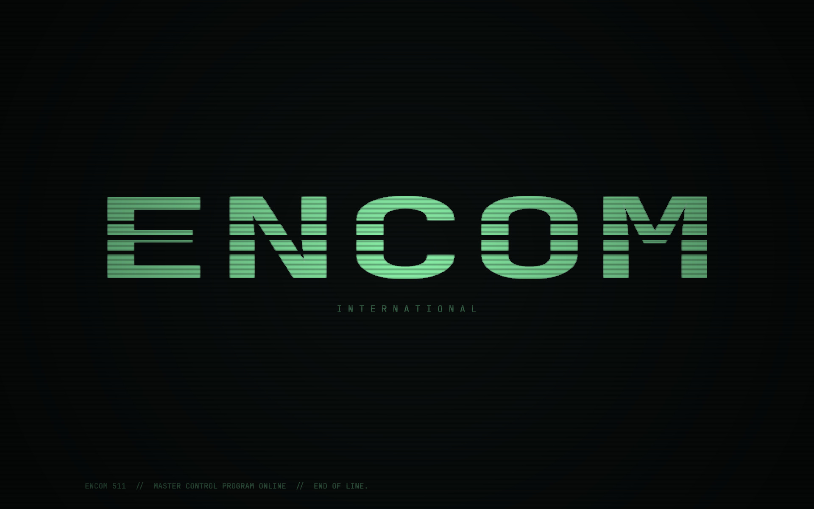
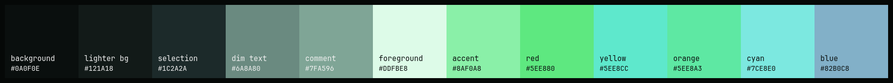

<div align="center">



# ENCOM Green

**A green-phosphor theme for [Omarchy](https://omarchy.org), as seen from the other side of the screen.**

[](https://omarchy.org)
[](https://hyprland.org)
[](LICENSE)
[](#)

</div>

```
> USER: DILLINGER
> PASSWORD: ********

  ACCESS GRANTED.

MCP: GOOD EVENING, ED.
```

---

## Outside the Grid

Most Tron themes put you *inside* the machine: glowing blue circuits, red enemies, light cycles.

This one doesn't. It's 1982, you're on the executive floor at ENCOM, and the only view of the Master Control Program is a green-screen terminal built into a desk. No neon and no light cycles, just a humming CRT, a blinking cursor, and a program that has gotten a little too comfortable running the company.

The colors themselves are restrained. ENCOM Green is built on the palette of Omarchy's own **Hackerman** theme, nudged toward the soft green of a P1 phosphor tube, so it's comfortable for a full workday rather than a screenshot that wears thin by lunch.

## Screens

<table>
<tr>
<td width="50%"></td>
<td width="50%"></td>
</tr>
<tr>
<td align="center"><sub><b>1 · Master Control</b><br>The MCP reports in: an intruder traced, a port closed, the Pentagon pending.</sub></td>
<td align="center"><sub><b>2 · ENCOM International</b><br>The wordmark, cut by scanlines, with a phosphor glow.</sub></td>
</tr>
</table>

Both wallpapers are drawn by [`render.sh`](render.sh), not downloaded. The text is set in JetBrains Mono, then given a soft phosphor bloom, 3&nbsp;px scanlines and a CRT vignette. Cycle between them with `omarchy theme bg next`.

## Install

```bash
omarchy theme install https://github.com/ClarkMichaelA/omarchy-encom-green-theme
```

It shows up as **Encom Green** in the theme picker. Or apply it straight away:

```bash
omarchy theme set encom-green
```

## Palette



| Role | Hex | |
|---|---|---|
| Background | `#0A0F0E` | Hackerman's navy-black, with a hint of green |
| Foreground | `#DDFBE8` | Mint-white instead of icy blue-white |
| Accent | `#8AF0A8` | Soft phosphor green, a little gentler than Hackerman's |
| Comments & quiet UI | `#7FA596` | Sage, legible at a glance |
| Borders | `#26A269 → #2EC27E` | Hackerman's own green gradient at 45° |

Hackerman's blues are tilted slightly toward teal, so functions and links still stand apart without breaking the green-screen look.

## What gets themed

Omarchy generates most app configs from [`colors.toml`](colors.toml), so ENCOM Green covers:

- **Desktop:** Hyprland borders, the Omarchy bar, menus, notifications and OSD
- **Terminals:** Alacritty, Ghostty, Kitty and Foot
- **Tools:** btop, Neovim, Helix, Chromium, the Obsidian stylesheet and more
- **Icons:** Yaru `sage`
- **VS Code, Cursor and VSCodium:** a hand-tuned [`vscode-theme.json`](vscode-theme.json)

### A note on the VS Code theme

Omarchy's stock VS Code template draws comments, line numbers, breadcrumbs and inactive tabs in the theme's `muted` color. On a palette this dark, that color is close to invisible. ENCOM Green ships its own `vscode-theme.json` that fixes this:

- Comments, breadcrumbs, inactive tabs, activity bar icons, placeholders, descriptions, inlay hints and CodeLens use `#7FA596`
- Line numbers use `#66857A`, one step quieter, and the current line stays bright
- Status bar badges such as **Restricted Mode** use dark text on the accent, not white

`muted` is still used for borders, indent guides and scrollbars, where a subtle color belongs.

## Make it yours

The MCP greets whoever `render.sh` tells it to. The published wallpapers say **ED**, as in the film:

```bash
cd ~/.config/omarchy/themes/encom-green
NAME=FLYNN ./render.sh
omarchy theme set encom-green
```

The whole session transcript lives in [`mcp.txt`](mcp.txt). Edit it and re-run the script to change what the MCP says. `render.sh` needs ImageMagick 7 and JetBrains Mono Nerd Font, which Omarchy ships with.

## Prefer amber?

**[ENCOM](https://github.com/ClarkMichaelA/omarchy-encom-theme)** is the same terminal with a warm amber tube.

```bash
omarchy theme install https://github.com/ClarkMichaelA/omarchy-encom-theme
```

## Credits

- Built on the palette of **Hackerman**, one of the themes that ships with [Omarchy](https://github.com/basecamp/omarchy)
- Typeface: [JetBrains Mono](https://www.jetbrains.com/lp/mono/)

*TRON, ENCOM and the Master Control Program belong to Disney. This is an unofficial fan theme with no affiliation to or endorsement from Disney. The wordmark here is an original lettering in the spirit of the film, not the studio's artwork.*

<div align="center">

```
MCP: END OF LINE.
```

</div>
